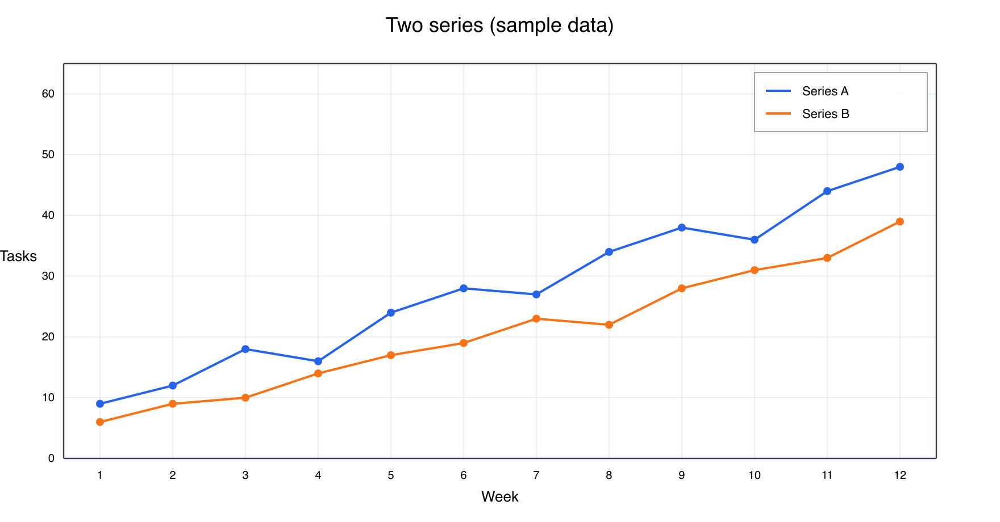
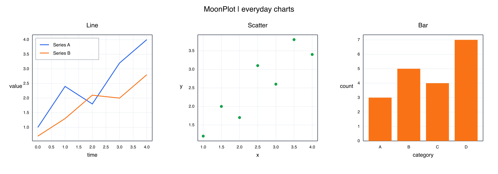
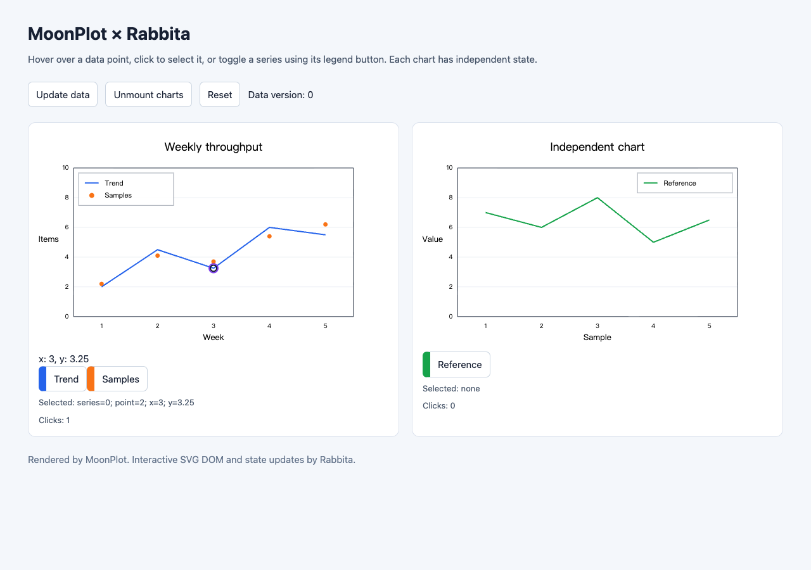

# MoonPlot

A plotting library written in [MoonBit](https://www.moonbitlang.com/).
Create figures, add charts and annotations, and export self-contained SVG
for reports, documentation, and applications.

MoonPlot focuses on useful plotting features that can grow incrementally.
Its API takes inspiration from Matplotlib, with typed MoonBit data and
an SVG rendering pipeline.



[View the SVG](assets/two-series.svg) ·
[Run this example](cmd/preview/main.mbt)

## Features

- **Everyday charts:** line, scatter, bar, histogram, pie, box, and violin plots.
- **Scientific plots:** error bars, filled regions, contours, triangulated meshes,
  vector fields, and stream plots.
- **Images and color:** scalar and RGB(A) images, heatmaps, color maps,
  normalization, masks, and colorbars.
- **Figure composition:** multiple axes, shared axes, nested grids, secondary
  axes, titles, labels, legends, tables, and annotations.
- **Axes and data:** numeric scales, explicit ticks and formatters, date/time
  coordinates, time zones, and categorical labels.
- **Editable lines:** data updates, visibility, color, alpha, line width,
  draw styles, dashes, and gap colors through `Line2D` handles.
- **SVG output:** render a figure to a string without a Python runtime.
- **Rabbita components:** an optional JS adapter provides real SVG DOM nodes,
  point hover and selection, legend buttons, and reactive data updates.

Support varies by chart and option. See the
[usage guide](docs/USAGE.md) for examples and the
[current capabilities](docs/CAPABILITIES.md) and
[API behavior notes](docs/COMPATIBILITY.md) for detailed boundaries.

## Getting Started

Install the [MoonBit toolchain](https://www.moonbitlang.com/download/).
The native example also requires a working C compiler.

Clone the repository, install its declared dependencies, and render the preview:

```sh
git clone https://github.com/moonbit-community/moonplot.git
cd moonplot
moon install
moon run cmd/preview --target native > chart.svg
```

Open `chart.svg` in a browser or an SVG viewer. The command writes the chart
to standard output; the shell redirects it to the file.

If your local package index needs refreshing, run `moon update` before
`moon install`. Some recent toolchains warn that `moon install` is deprecated;
it remains an explicit dependency setup command for the current checkout.
See the [Moon CLI documentation](https://docs.moonbitlang.com/en/latest/toolchain/moon/commands.html)
for your toolchain's dependency workflow.

The checked-in PNG above is a preview of the SVG output. MoonPlot does not
currently provide standalone PNG export.

## Library Usage

The repository and project are named **MoonPlot**. The current MoonBit module
ID is still **`mathplotlib/mathplotlib`**, so imports retain that name.
The repository rename does not introduce a `moonbit-community/moonplot`
Mooncakes module.

A package using the library imports the root plotting API in `moon.pkg`:

```moonbit nocheck
///|
import {
  "mathplotlib/mathplotlib",
}
```

Create a figure, choose its axes, add data, and request SVG output.
This compact example uses explicit limits and ticks:

```moonbit nocheck
///|
fn main raise {
  let fig = @mathplotlib.figure(width=640, height=400)
  fig.set_title("A MoonPlot chart")
  fig.set_x_label("Sample")
  fig.set_y_label("Value")
  fig.set_x_limits(0.0, 4.0)
  fig.set_y_limits(0.0, 20.0)
  fig.set_x_ticks([0.0, 1.0, 2.0, 3.0, 4.0])
  fig.set_y_ticks([0.0, 5.0, 10.0, 15.0, 20.0])
  fig.set_x_tick_labels(["0", "1", "2", "3", "4"])
  fig.set_y_tick_labels(["0", "5", "10", "15", "20"])
  fig.plot(
    [0.0, 1.0, 2.0, 3.0, 4.0],
    [3.0, 7.0, 5.0, 13.0, 17.0],
    color="#2563eb",
    label="Measurements",
  )
  fig.legend(fig.legend_entries())
  println(fig.to_svg_checked())
}
```

Use the object API for individual figures and axes, or the
[`pyplot` package](pyplot) for a stateful facade.
For mutable line data and appearance, `plot_line` returns a `Line2D` handle.
The complete two-series example is in [`cmd/preview`](cmd/preview/main.mbt).

The checked rendering APIs propagate data, tick, and layout errors so callers
can handle them. The [first usable milestone](docs/MILESTONE_M1.md) records
the workflows checked for basic SVG output; more complex combinations continue
to evolve.

### Gallery and legend placement

```sh
moon run cmd/gallery --target native > gallery.svg
```

This example combines line, scatter, and categorical bar charts with automatic
ranges and ticks. Set a legend corner with
`axes.set_legend_position(@mathplotlib.LegendPosition::UpperLeft)`.
`UpperRight` (the default), `LowerLeft`, and `LowerRight` are also available.



[View the SVG](assets/gallery.svg) · [Example source](cmd/gallery/main.mbt)

### Interactive Rabbita components

`Figure::to_drawing()` prepares the SVG and data-point hit locations together.
The optional [`moonplot-rabbita` adapter](adapters/rabbita/README.md) turns that
snapshot into composable Rabbita `Html` using public SVG node constructors.
The application owns hover, selection, visibility, and data state.

```sh
cd adapters/rabbita
moon build cmd/demo --target js
python3 -m http.server 8765 --bind 127.0.0.1
```

Open [the local example](http://127.0.0.1:8765) to interact with two independent
charts. The adapter is a separate JS module linked by a local `moon.work`;
it has not been published to Mooncakes. Core SVG usage keeps its existing
dependencies. See the [component guide](adapters/rabbita/README.md) for the API
and [DOM acceptance notes](docs/RABBITA_DOM.md) for tested behavior and limits.



### Current scope

- SVG is the static output backend; Rabbita DOM is an optional browser component.
  Standalone PNG/PDF export and a desktop GUI backend are not available.
- Interactive picking currently covers line/scatter data-point anchors.
  Touch gestures, zoom/pan, and keyboard navigation remain future work.
- 3D plotting, animation, and full mathtext/TeX and font layout are not available.
- The library is not a drop-in Matplotlib implementation. Python's dynamic
  argument forms and every chart parameter are not reproduced.
- SVG text uses the viewer's fonts; full text measurement and typography remain
  limited.

## Documentation

- [Documentation index](docs/README.md)
- [Detailed usage and API examples](docs/USAGE.md)
- [Current capabilities and M1 acceptance](docs/CAPABILITIES.md)
- [Four capability goals](docs/MIGRATION_PLAN.md)
- [Rabbita interactive DOM and acceptance](docs/RABBITA_DOM.md)
- [Dependencies and integration notes](docs/DEPENDENCIES.md)
- [Third-party licenses and attribution](docs/THIRD_PARTY_NOTICES.md)

The root package provides the common plotting facade. Implementation packages
include `scene` for figure and artist state, `ticker` for axes and date handling,
`transforms` for geometry, and `backend/svg` for rendering.
The facade is kept in [`api.mbt`](api.mbt), consumer tests in [`tests/api`](tests/api),
and isolated configuration tests in [`tests/integration`](tests/integration).
See the [source organization guide](docs/ARCHITECTURE.md) for package boundaries,
generated resources, and reference fixtures.

## Development

From the repository root:

```sh
python3 tools/check_structure.py
moon check --target all
moon test --target all
moon info
moon fmt
```

Tests include unit tests, public API examples, SVG checks, and source-reference
fixtures. Guides under [`testdata/`](testdata) describe their supported domains
and reproduction steps. Python is used by some fixture generators, not by the
plotting runtime.

When changing public APIs, review the generated `pkg.generated.mbti` diffs.
Keep examples and capability notes aligned with the behavior that is tested.

## License

Licensed under the [Apache License 2.0](LICENSE).

Some algorithms and behavior are adapted from the pinned Matplotlib v3.11.2
source and retain its [license](docs/licenses/LICENSE-MATPLOTLIB).
Other dependencies and bundled data retain their own licenses; see
[Third-Party Notices](docs/THIRD_PARTY_NOTICES.md).
