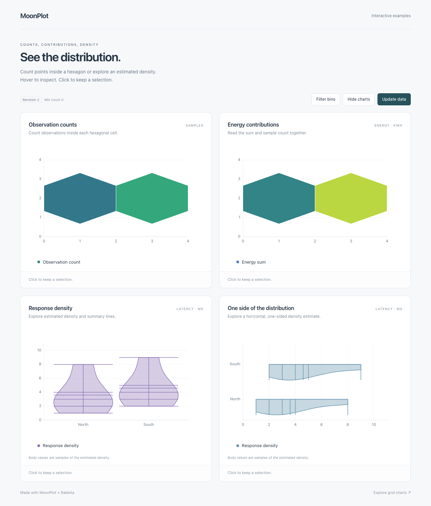
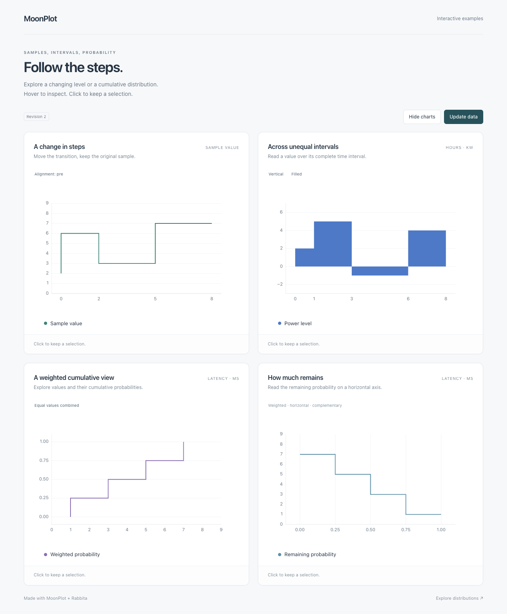
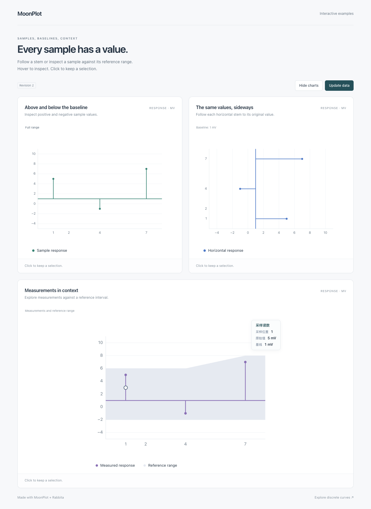
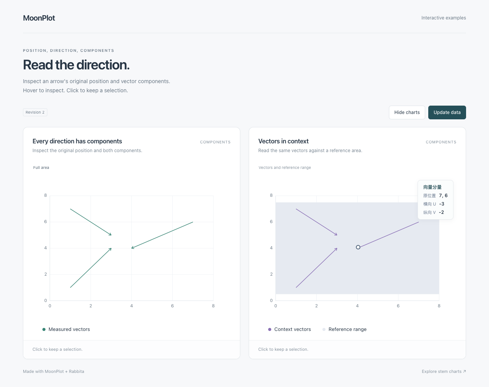
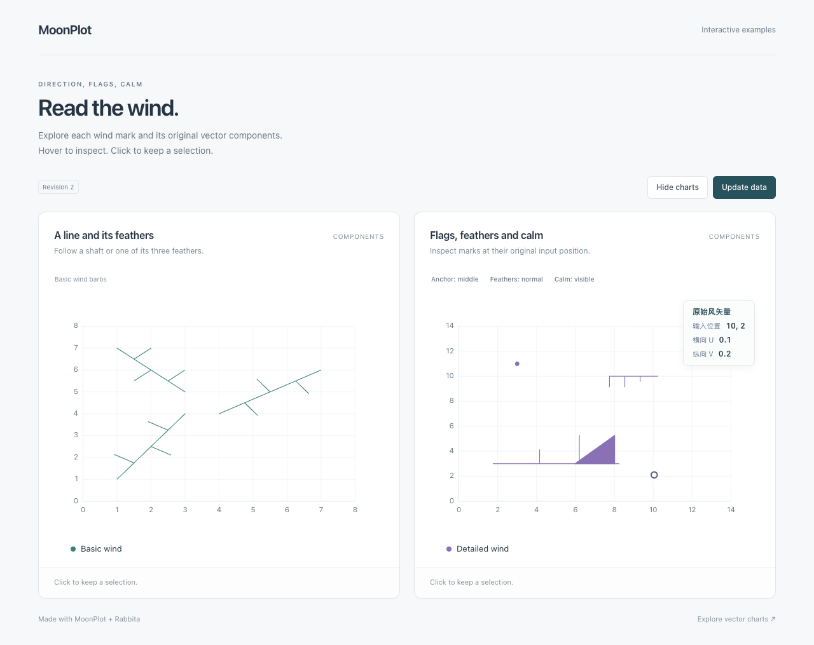
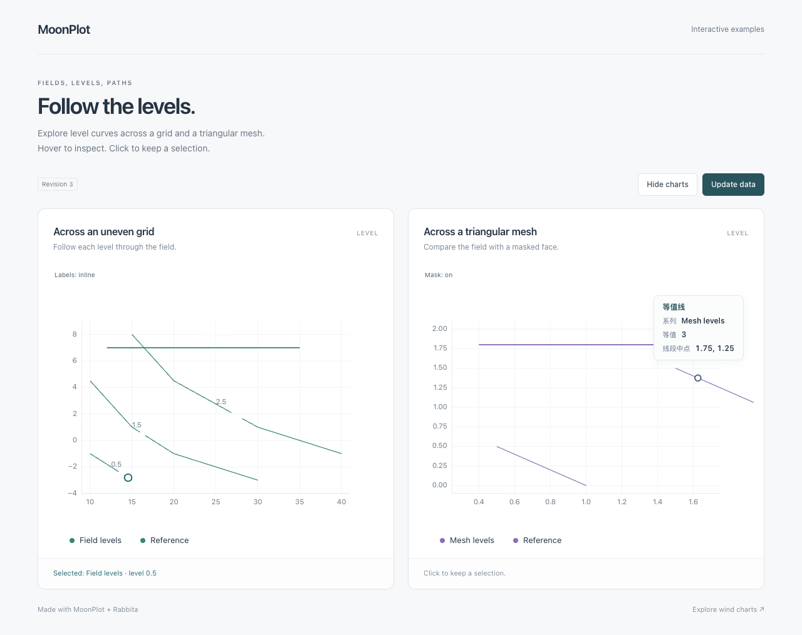
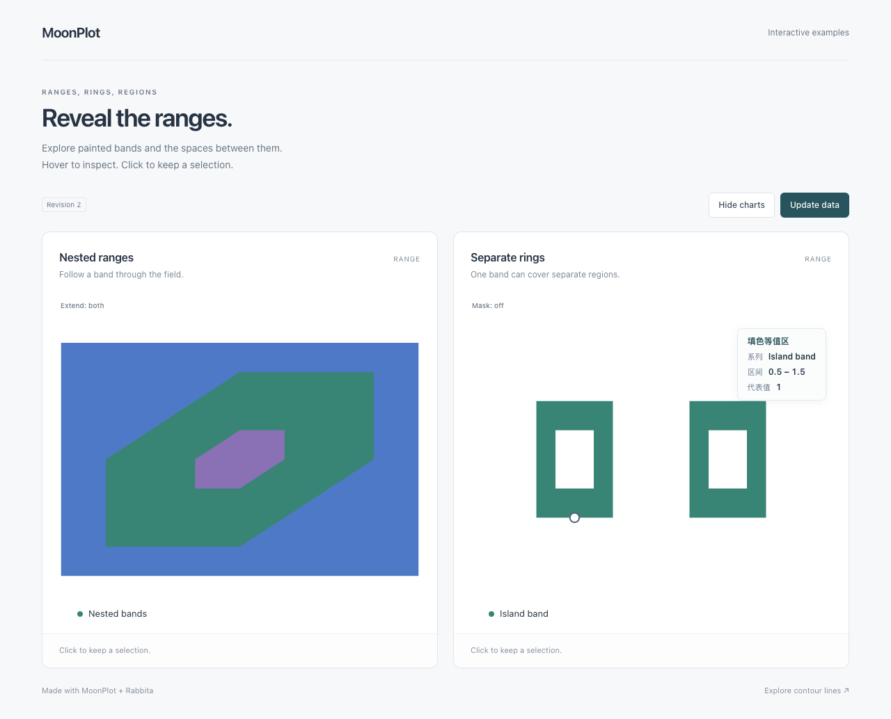
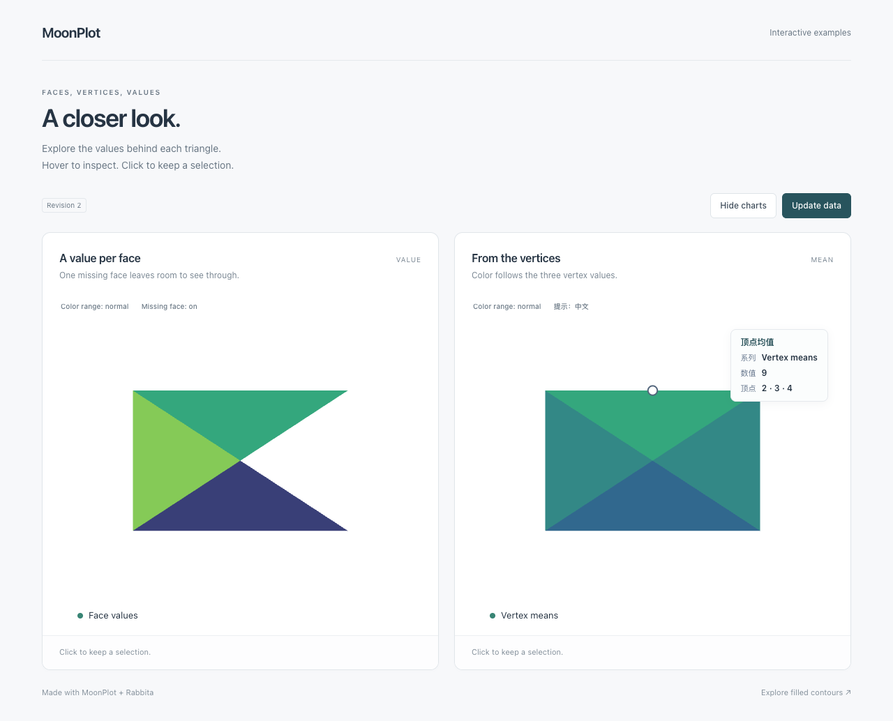
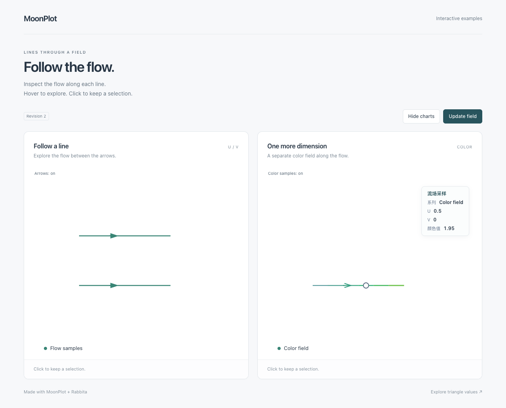
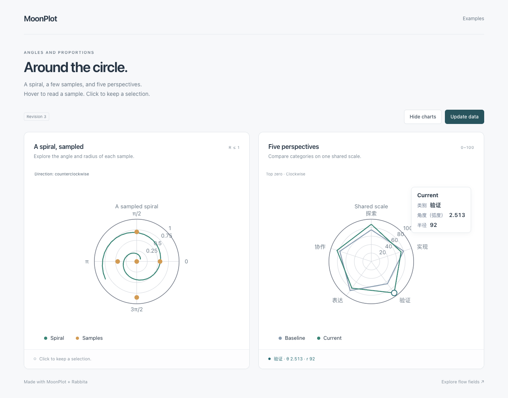

# MoonPlot

A plotting library written in [MoonBit](https://www.moonbitlang.com/).
Create figures, add charts and annotations, and export self-contained SVG
for reports, documentation, and applications.

MoonPlot focuses on useful plotting features that can grow incrementally.
Its API takes inspiration from Matplotlib, with typed MoonBit data and
an SVG rendering pipeline.


[View the SVG](assets/two-series.svg) ·
[Run this example](cmd/preview/main.mbt)

## Features

- **Everyday charts:** line, scatter, grouped/stacked bars, histogram, pie/donut,
  box, and violin plots.
- **Scientific plots:** error bars, filled regions, contours, triangulated meshes,
  vector fields, and stream plots.
- **Polar plots:** radial lines and scatter points, plus closed radar outlines
  with category labels, angle direction, radial ticks, and circular clipping.
- **Images and color:** scalar and RGB(A) images, heatmaps, color maps,
  normalization, masks, and colorbars.
- **Figure composition:** multiple axes, shared axes, nested grids, secondary
  axes, titles, labels, legends, tables, and annotations.
- **Axes and data:** numeric scales, explicit ticks and formatters, date/time
  coordinates, time zones, and categorical labels.
- **Editable lines:** data updates, visibility, color, alpha, line width,
  draw styles, dashes, and gap colors through `Line2D` handles.
- **SVG output:** render a figure to a string without a Python runtime.
- **Rabbita components:** an optional JS adapter provides real SVG DOM nodes,
  point and region hover, line x snapping, selection, legend buttons, reactive data
  updates, scoped SVG resources, and customizable semantic tooltips.
- **Statistical interactions:** error arms/caps, confidence and stacked-area interiors,
  and boxplot bodies/whiskers/outliers expose typed ranges and statistics. See the [statistics guide](docs/STATISTICS.md).
- **Matrix and bin interactions:** nearest scalar images and flat rectangular
  meshes expose original row, column, value and data intervals across whole cells;
  2D histograms expose both bin intervals and their original counts. See the [mesh guide](docs/MESH_INTERACTION.md).
- **Distribution interactions:** hexagonal bins expose counts and aggregation values
  across their actual faces; violin bodies expose KDE samples and statistical
  strokes. See the [hexbin](docs/HEXBIN_INTERACTION.md) and
  [violin](docs/VIOLIN_INTERACTION.md) guides.

Support varies by chart and option. See the
[usage guide](docs/USAGE.md) for examples and the
[current capabilities](docs/CAPABILITIES.md) and
[API behavior notes](docs/COMPATIBILITY.md) for detailed boundaries.

## Getting Started

MoonPlot uses the **`Lampese/mathplotlib@0.17.0`** module. See [publication status and installation instructions](docs/PUBLISHING.md).
From your application's module directory, add it with:

```sh
moon add Lampese/mathplotlib@0.17.0
```

Import `Lampese/mathplotlib` for static plotting, and add
`Lampese/mathplotlib/rabbita` when composing browser components. Both packages
come from the same installation. The package alias `@mathplotlib` and plotting
method names stay the same. Installing this module resolves its declared
Rabbita dependencies too; the core plotting packages do not import UI types.

### Run the repository examples

Install the [MoonBit toolchain](https://www.moonbitlang.com/download/).
The native example also requires a working C compiler.

```sh
git clone https://github.com/moonbit-community/moonplot.git
cd moonplot
moon run cmd/preview --target native > chart.svg
moon build rabbita/cmd/demo --target js
python3 -m http.server 8765 --bind 127.0.0.1
```

Open `chart.svg` in a browser or SVG viewer. Open
[the interactive example](http://127.0.0.1:8765/rabbita/) for hover, selection,
legend toggles and data updates. Serve the repository root so the example can
load its built JavaScript; stop the server with Ctrl+C.
Moon resolves the declared dependencies when building. Run `moon update` if
your local registry index needs refreshing.

The checked-in PNG above is a preview of the SVG output. MoonPlot does not
currently provide standalone PNG export.

## Library Usage

The project is named **MoonPlot** and its module ID is **`Lampese/mathplotlib`**.
When migrating from the earlier source release, replace the old
`mathplotlib/mathplotlib` prefix with `Lampese/mathplotlib`. Existing
`@mathplotlib` calls remain valid; see the [path migration notes](docs/PUBLISHING.md).

A package using the library imports the root plotting API in `moon.pkg`:

```moonbit nocheck
///|
import {
  "Lampese/mathplotlib",
}
```

Create a figure, choose its axes, add data, and request SVG output.
This compact example uses explicit limits and ticks:

```moonbit nocheck
///|
fn main raise {
  let fig = @mathplotlib.figure(width=640, height=400)
  fig.set_title("A MoonPlot chart")
  fig.set_x_label("Sample")
  fig.set_y_label("Value")
  fig.set_x_limits(0.0, 4.0)
  fig.set_y_limits(0.0, 20.0)
  fig.set_x_ticks([0.0, 1.0, 2.0, 3.0, 4.0])
  fig.set_y_ticks([0.0, 5.0, 10.0, 15.0, 20.0])
  fig.set_x_tick_labels(["0", "1", "2", "3", "4"])
  fig.set_y_tick_labels(["0", "5", "10", "15", "20"])
  fig.plot(
    [0.0, 1.0, 2.0, 3.0, 4.0],
    [3.0, 7.0, 5.0, 13.0, 17.0],
    color="#2563eb",
    label="Measurements",
  )
  fig.legend(fig.legend_entries())
  println(fig.to_svg_checked())
}
```

Use the object API for individual figures and axes, or the
[`pyplot` package](pyplot) for a stateful facade.
For mutable line data and appearance, `plot_line` returns a `Line2D` handle.
The complete two-series example is in [`cmd/preview`](cmd/preview/main.mbt).

The checked rendering APIs propagate data, tick, and layout errors so callers
can handle them. The [first usable milestone](docs/MILESTONE_M1.md) records
the workflows checked for basic SVG output; more complex combinations continue
to evolve.

### Gallery and legend placement

```sh
moon run cmd/gallery --target native > gallery.svg
```

This example combines line, scatter, and categorical bar charts with automatic
ranges and ticks. Set a legend corner with
`axes.set_legend_position(@mathplotlib.LegendPosition::UpperLeft)`.
`UpperRight` (the default), `LowerLeft`, and `LowerRight` are also available.


[View the SVG](assets/gallery.svg) · [Example source](cmd/gallery/main.mbt)

### Interactive Rabbita components

`Figure::to_drawing()` prepares the SVG and data-point hit locations together.
The [`rabbita` package](rabbita/README.md) turns that snapshot into composable
Rabbita `Html` using public SVG node constructors. Add it to your application's
`moon.pkg` with an explicit alias:

```moonbit nocheck
///|
import {
  "Lampese/mathplotlib",
  "Lampese/mathplotlib/rabbita" @plot_dom,
  "moonbit-community/rabbita",
}
```

The application owns hover, selection, visibility and data state. The browser
package declares `supported_targets = "js"`; the core facade, Scene, Drawing
and static renderer keep their platform-independent interfaces. No separate
adapter module or local workspace is needed. See the [component guide](rabbita/README.md)
for a complete view and the [DOM notes](docs/RABBITA_DOM.md) for tested behavior.


### Hover values and formatting

The [tooltip guide](docs/TOOLTIPS.md) covers full-bar hit regions, line samples selected
by horizontal position, histogram bins and pie slices, and application-defined units,
dates, labels and styling. Run the six-chart example:

```sh
moon build rabbita/cmd/tooltips --target js
```

With the repository served as above, open
[the tooltip examples](http://127.0.0.1:8765/rabbita/tooltips.html).
Use `hit_mode=XNearest` to opt into line x snapping; existing calls keep nearest-point picking.

### Hexagonal bins and violin distributions

```sh
moon build rabbita/cmd/distributions --target js
```

Open [the four-chart distribution example](http://127.0.0.1:8765/rabbita/distributions.html)
to inspect counts, custom reductions, KDE density samples and statistical parts.
Version 0.7.0 also corrects the earlier hexbin partition: point assignment and
polygon vertices now share the same hexagonal lattice. Hexbin centers, counts,
aggregation groups and SVG geometry can change; see the
[compatibility details](docs/HEXBIN_INTERACTION.md).



### Step, interval stairs and cumulative distributions

```sh
moon build rabbita/cmd/discrete --target js
```

Open [the four-chart discrete example](http://127.0.0.1:8765/rabbita/discrete.html)
to switch step alignment and stairs orientation, inspect weighted CDF/CCDF jumps,
and try independent legends and data updates. Tooltips retain original samples,
directed intervals and the probabilities returned by the existing ECDF calculation.
See the [step](docs/STEP_INTERACTION.md), [stairs](docs/STAIRS_INTERACTION.md)
and [ECDF](docs/ECDF_INTERACTION.md) guides for exact identities and supported geometry.



### Stem values and baselines

```sh
moon build rabbita/cmd/stems --target js
```

Open [the three-chart stem example](http://127.0.0.1:8765/rabbita/stems.html)
to inspect original samples along a rod or at its head. Vertical and horizontal
stems retain signed values and nonzero baselines; missing samples keep their
original indices. The example also combines stems with a confidence band.
See the [stem guide](docs/STEM_INTERACTION.md) for source identities and clipping.



### Vector arrows and original components

```sh
moon build rabbita/cmd/vectors --target js
```

Open [the vector example](http://127.0.0.1:8765/rabbita/vectors.html) to inspect
original X/Y positions and signed U/V components along the actual shaft and
both arrow wings. Zero vectors preserve later input indices; clipped strokes
retain the original source position. A second chart overlays vectors on a
reference band. See the [Quiver guide](docs/QUIVER_INTERACTION.md).



### Wind barbs, flags and calm symbols

```sh
moon build rabbita/cmd/barbs --target js
```

Open [the wind example](http://127.0.0.1:8765/rabbita/barbs.html) to inspect
the shaft, feathers, filled flags and calm disks. Tooltips retain original input
positions, indices and signed U/V, including nonzero vectors rounded to calm.
The second card switches the existing anchor, feather direction and calm
visibility options. See the [Barbs guide](docs/BARBS_INTERACTION.md).



### Contour levels and inline labels

```sh
moon build rabbita/cmd/contours --target js
```

Open [the contour example](http://127.0.0.1:8765/rabbita/contours.html) to inspect
regular-grid and triangular level curves. Actual visible strokes expose the exact
level and original series, including both fragments around inline labels. The
[contour guide](docs/CONTOUR_INTERACTION.md) explains generated path indices,
clipping and geometry midpoint anchors.



### Filled contour bands and holes

```sh
moon build rabbita/cmd/filled_contours --target js
```

Open [the filled contour example](http://127.0.0.1:8765/rabbita/filled-contours.html)
to inspect nested bands and separate islands. Tooltips show the scalar interval,
representative value and original series. Whole-region picking preserves holes,
the original band slots and the space between islands through data and mask updates.
See the [filled contour guide](docs/CONTOURF_INTERACTION.md).



### Triangular face values and vertex means

```sh
moon build rabbita/cmd/triangles --target js
```

Open [the triangular mesh example](http://127.0.0.1:8765/rabbita/triangles.html)
to inspect original face values or vertex arithmetic means. Whole-face picking
preserves masked gaps, original face indices and ordered vertex triples through
normalization, data and visibility updates. Default and Chinese custom tooltips
share the same typed metadata. See the [tripcolor guide](docs/TRIPCOLOR_INTERACTION.md).



### Continuous streamlines and sampled fields

```sh
moon build rabbita/cmd/streamlines --target js
```

Open [the streamplot example](http://127.0.0.1:8765/rabbita/streamlines.html)
to inspect U/V field samples along continuous body strokes. The same frame
retains the original seed and generated-edge indices, with optional raw color
values before normalization. Default and Chinese custom tooltips update with
the field and style grids. See the [streamplot guide](docs/STREAMPLOT_INTERACTION.md)
for generated midpoint semantics and the static arrow boundary.



### Polar plots and radar outlines

```sh
moon build rabbita/cmd/polar --target js
```

Open [the polar and radar example](http://127.0.0.1:8765/rabbita/polar.html)
to change data, switch angle direction, toggle each series, and remount both
charts. `Figure::add_polar_axes` accepts raw angles in radians and nonnegative
radii. Radar profiles retain their original categories and share one radial
scale. Both SVG and Rabbita DOM use a true circular clip in rectangular panels.
Hover or click the original polar samples to see radians, radius and radar
categories. Both hit modes require physical point proximity inside the actual
circle; tooltip content and units can be customized. See the [polar guide](docs/POLAR.md).



### Current scope

- SVG is the static output backend; Rabbita DOM is an optional browser component.
  Standalone PNG/PDF export and a desktop GUI backend are not available.
- Interactive picking includes line/scatter anchors, bar and histogram regions,
  pie/donut sectors, matrix cells, statistical areas, distribution parts, discrete curves, stems, quiver arrows, wind barbs, line contours, filled contour bands, triangular faces, continuous streamline bodies and original polar samples.
  Touch gestures, zoom/pan, and keyboard navigation remain future work.
- 3D plotting, animation, and full mathtext/TeX and font layout are not available.
- The library is not a drop-in Matplotlib implementation. Python's dynamic
  argument forms and every chart parameter are not reproduced.
- SVG text uses the viewer's fonts; full text measurement and typography remain
  limited.

## Documentation

- [Documentation index](docs/README.md)
- [Detailed usage and API examples](docs/USAGE.md)
- [Current capabilities and milestone acceptance](docs/CAPABILITIES.md)
- [Installation, module paths and release status](docs/PUBLISHING.md)
- [M2 interactive plotting and source-release history](docs/MILESTONE_M2.md)
- [Filled contour regions and holes: completed M12](docs/MILESTONE_M12.md)
- [Triangular face values and vertex means: completed M13](docs/MILESTONE_M13.md)
- [Continuous streamline field samples: completed M14](docs/MILESTONE_M14.md)
- [Polar plots and radar outlines: completed M15](docs/MILESTONE_M15.md)
- [Delivered M16: original polar values and circular picking](docs/MILESTONE_M16.md)
- [Current M17: polar bars and rose plots](docs/MILESTONE_M17.md)
- [Four capability goals](docs/MIGRATION_PLAN.md)
- [Rabbita interactive DOM and acceptance](docs/RABBITA_DOM.md)
- [Dependencies and integration notes](docs/DEPENDENCIES.md)
- [Third-party licenses and attribution](docs/THIRD_PARTY_NOTICES.md)

The root package provides the common plotting facade. Implementation packages
include `scene` for figure and artist state, `ticker` for axes and date handling,
`transforms` for geometry, and `backend/svg` for rendering.
The facade is kept in [`api.mbt`](api.mbt), consumer tests in [`tests/api`](https://github.com/moonbit-community/moonplot/tree/master/tests/api),
and isolated configuration tests in [`tests/integration`](https://github.com/moonbit-community/moonplot/tree/master/tests/integration).
See the [source organization guide](docs/ARCHITECTURE.md) for package boundaries,
generated resources, and reference fixtures.

## Development

From the repository root:

```sh
python3 tools/check_structure.py
moon check --target all
moon test --target all
python3 tools/update_interfaces.py
moon fmt
```

Tests include unit tests, public API examples, SVG checks, and source-reference
fixtures. Guides under [`testdata/`](testdata) describe their supported domains
and reproduction steps. Python is used by some fixture generators, not by the
plotting runtime.

When changing public APIs, review the generated `pkg.generated.mbti` diffs.
Keep examples and capability notes aligned with the behavior that is tested.

## License

Licensed under the [Apache License 2.0](LICENSE).

Some algorithms and behavior are adapted from the pinned Matplotlib v3.11.2
source and retain its [license](docs/licenses/LICENSE-MATPLOTLIB).
Other dependencies and bundled data retain their own licenses; see
[Third-Party Notices](docs/THIRD_PARTY_NOTICES.md).
