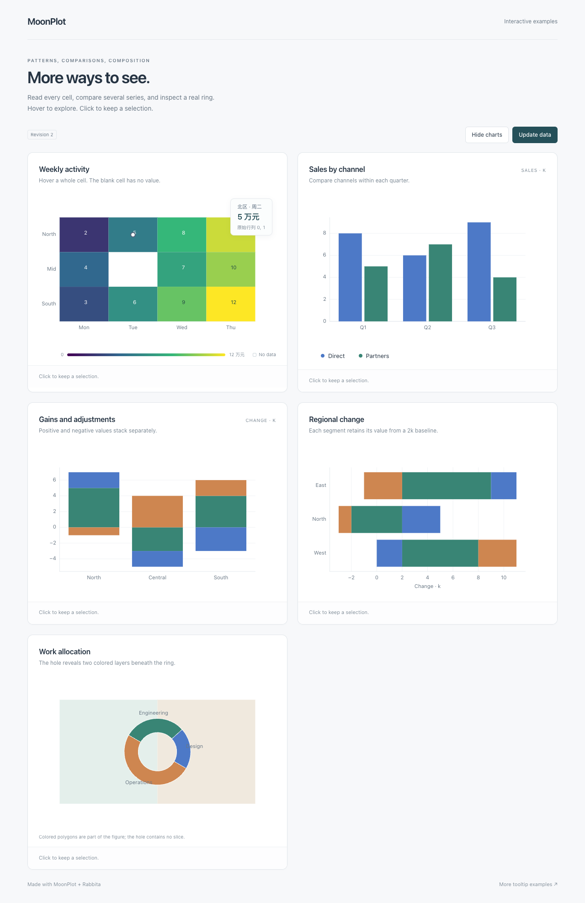

# 热图、分组/堆叠柱与环形图

0.4.0 扩展三类日常图表，继续使用统一的 `Lampese/mathplotlib` module。
核心负责 SVG、真实几何和语义命中；浏览器应用组合 `Lampese/mathplotlib/rabbita` 的 `view`。

## 可运行示例

```sh
moon build rabbita/cmd/charts --target js
python3 -m http.server 8765 --bind 127.0.0.1
```

从仓库根服务，打开 [M3 图表示例](http://127.0.0.1:8765/rabbita/charts.html)。
五张图展示热图中文提示、分组柱、正负堆叠、横向堆叠和露出底层颜色的环形图，
包含图例重建、数据更新和重新挂载。示例源见 [charts](../rabbita/cmd/charts/main.mbt)。

## 热图：读取原始单元格

```moonbit nocheck
let fig = @mathplotlib.figure(width=600, height=360)
fig.imshow(
  [[2.0, 5.0, 8.0], [4.0, 0.0 / 0.0, 7.0]],
  cmap="viridis",
  origin="upper",
  interpolation="nearest",
  aspect="auto",
)
let drawing = fig.to_drawing()
```

标量 `imshow`、`matshow` 及对应 masked/custom-colormap 入口在 nearest 模式下提供整格命中。
有效且可见的格子使用 `HitKind::Heatmap`；`HitInfo.value` 是归一化前的原始值。
`HitInfo.cell : CellInfo?` 包含零基 `row`、`column`、`x_range`、`y_range`。
两个范围保留该次绘制的原始数据方向，允许显式反向 extent。
`HitPoint.data_x/data_y` 是格子的数据中心，`point_index = row * columns + column`，缺失格不重排后续索引。

默认浮层显示 Row、Column、Value；应用可以从自身标签数组取得中文行列名：

```moonbit nocheck
@plot_dom.view(
  drawing,
  id="sales-matrix",
  on_event=event => emit(Chart(event)),
  hovered?=model.hovered,
  tooltip=info => {
    let cell = info.cell.unwrap()
    @html.div([
      @html.b(regions[cell.row] + " · " + days[cell.column]),
      @html.span("\{info.value} 万元"),
    ])
  },
)
```

同一快照采集实际矩形并受面板和 SVG 图例裁剪。共享格边界按后绘制格优先，
包括交界顶点。非有限值、mask、零透明度以及完全透明的颜色不提供有效目标。
示例使用现有刻度和 text 提供行列标签、格内数值，外层 HTML 色条标明同一显式 vmin/vmax。
静态图也可组合现有 colorbar API。

本轮交互仅覆盖 nearest 标量格子。RGB(A)、none/平滑 PNG、pcolor/pcolormesh/hist2d
和不规则网格仍可静态绘制，但不因此获得本次的 cell 语义。查询当前仍线性扫描目标。

## 分组与堆叠柱

```moonbit nocheck
fig.grouped_bar(
  ["North", "South"],
  [[4.0, -2.0], [3.0, 5.0]],
  labels=["Direct", "Partners"],
  colors=["#398575", "#4d79c7"],
  width=0.8,
  gap=0.1,
)
```

`series` 是按系列组织的二维数组，每个内层数组对应分类顺序。
`stacked_bar` 使用相同数据结构，分别累计正负值，支持非零 `baseline`；
两种入口都能设置 `horizontal=true`。整段提示保留原始分段值、系列名和类别，
而不是把累计顶点当成数值。完整参数、缺失值与输入检查见 [多系列柱图](MULTISERIES_BARS.md)。

## 环形图

```moonbit nocheck
let portions = fig.donut(
  [12.0, 8.0, 5.0],
  labels=["开发", "设计", "其他"],
  inner_radius=0.55,
  start_angle=90.0,
)
```

`inner_radius` 是内外半径比例，合法范围为有限的 `[0,1)`。
真实环孔会透出下方图形，完整单片圆环也保留环孔。Figure 本身仍有白色画布背景。
环内提示沿用 Pie 分类、原始值和占比；孔内与外圆外不命中。
详细几何和输入范围见 [环形图](DONUT.md)。

## 兼容现有应用

既有 `HitPoint`、`Interaction` 和普通 bar/barh/pie 调用继续使用。
新增 `CellInfo`、`HitInfo.cell` 与 `HitKind::Heatmap`，以及 `Artist::BarSegments`、`Artist::Donut`
和 `HitShape::AnnularSector`。穷尽匹配相关枚举的应用需补充分支或合适的默认分支。
环形图沿用 `HitKind::Pie`，多系列柱沿用 `Bar`/`BarH`。

新数据应生成新 Drawing；应用负责刷新 hover/selection 状态。
日期/单位/本地化、浮层样式及隐藏提示的方式与 [0.3.0 提示指南](TOOLTIPS.md)一致。

范围与逐项验收状态见 [M3](MILESTONE_M3.md)，实际命令和交付结果见 [执行检查点](MIGRATION_STATUS.md)。


