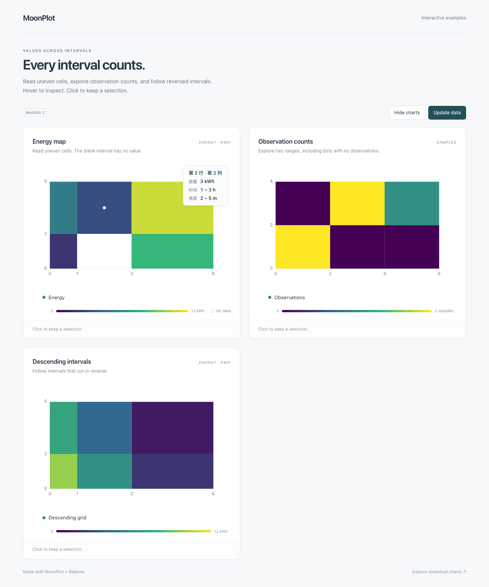

# 矩形网格与二维直方图交互

0.6.0 在已有静态入口上增加本页的语义交互。

`pcolor` / `pcolormesh` 的一维单元格边界入口现在支持整格 hover/click，
包括 `*_with_norm`、`*_with_norm_and_colormap` 与 masked 版本。
边界可以不等间距、递增或递减；其长度仍需比列数、行数各多一个。
静态调用和 SVG 输出保持不变。

```mbt nocheck
let fig = @mathplotlib.figure(width=640, height=360)
try! fig.pcolormesh(
  [[10.0, 20.0, 30.0], [40.0, 50.0, 60.0]],
  x=[0.0, 1.0, 3.0, 6.0],
  y=[0.0, 2.0, 8.0],
)
let frame = try! fig.to_drawing()
let point = frame.points()[1]
let info = frame.hit_info(point).unwrap()
// info.kind == Heatmap；info.value == 20。
// info.cell: row=0、column=1、x_range=(1,3)、y_range=(0,2)。
```

矩形网格复用 `Heatmap` 和只读 `CellInfo`。`row`、`column` 是原矩阵零基索引；
`point_index = row * columns + column`，缺失格不会重新编号。
`x_range`、`y_range` 保留源边界方向，反向坐标不会把它们排序。
`HitInfo.value` 始终是原始 scalar，不是归一化后的颜色值。
默认提示显示 Row、Column、Value；自定义 `tooltip` 可直接使用双区间、单位与中文标签。

masked、NaN、Inf、被 normalization 拒绝的 bad-color 占位格和完全透明格不提供有效取值目标。
`pcolor` 与 `pcolormesh` 原先的缺失格绘制差别保留：前者省略源缺失面，后者可以画出 bad color；
画出占位颜色不代表那里存在有效数值。

## 二维直方图

```mbt nocheck
let fig = @mathplotlib.figure(width=640, height=360)
try! fig.hist2d(
  [0.0, 0.2, 1.8, 2.0],
  [0.0, 0.2, 0.0, 2.0],
  bins_x=2,
  bins_y=2,
)
let histogram = try! fig.to_drawing()
```

`hist2d` 的提示为 `Histogram2D`，`info.cell` 给出 x/y 两个分箱区间，
`info.value` 是原始频数。默认浮层显示 x range、y range、Count；零频数格也能选中。
矩阵按 y 分箱为行、x 分箱为列，上例频数是 `[[2,1],[0,1]]`。
非有限的数据对整体跳过，不参与边界和频数计算；普通分箱左闭右开，最末分箱包含最大边界。
当前入口仍返回 Unit，支持已有 `bins_x` / `bins_y` 计数配置；没有权重或 density 语义。
颜色归一化不会改变频数。

单元格目标来自同次实际 polygon 绘制，使用真实 Rectangle 几何。
面板裁剪、图内图例排除、反向/有效非线性轴、多面板、CSS 缩放与 letterbox 沿用 Drawing 规则。
Drawing 保留独立快照，修改输入数组或重建图后，旧帧数据不会改变。
每个网格面仍对应现有的独立 Polygon artist；`artist_index` 表示该帧真实绘制顺序，
不是整个网格调用的系列编号。

二维坐标的 `pcolor_grid` / `pcolormesh_grid`、nearest/Gouraud、曲线或不规则四边形、
hexbin、二维密度与加权分箱不在本次交互范围内，已有静态绘制继续可用。
新增 `Histogram2D` 枚举变体后，穷尽匹配 `HitKind` 的调用方需要增加相应分支。

## 可运行三图示例

```sh
moon build rabbita/cmd/grids --target js
python3 -m http.server 8765 --bind 127.0.0.1
```

从仓库根服务，打开 [网格与二维计数示例](http://127.0.0.1:8765/rabbita/grids.html)。
[示例源码](../rabbita/cmd/grids/main.mbt)包括非均匀缺失网格、计数直方图和反向边界网格，
支持自定义中文单位、原始区间、独立显隐、更新与重新挂载。

0.6.0 同时修复旧普通 bar/barh 在 Logit 值轴上端点越域、区间却穿过有效视图时被丢弃的问题。
沿用已有分段柱区间计算，保留原值、类别、原始索引与实际矩形命中；
合法端点、线性和 Log 图的 SVG 保持逐字一致。类别轴仍沿用原先的有效性检查。

验收与当前交付状态见 [M5](MILESTONE_M5.md) 和 [执行检查点](MIGRATION_STATUS.md)。


