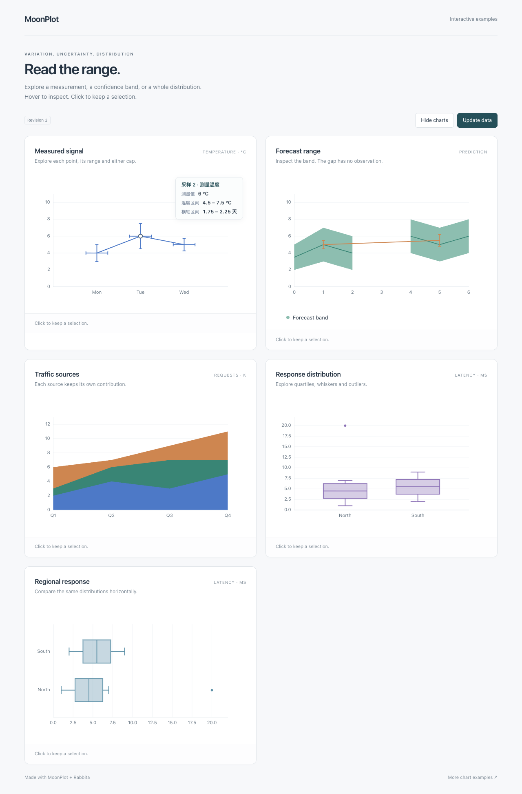

# 统计图与区间的交互

0.5.0 在现有静态入口上补齐误差棒、面积／置信带、堆叠面积和箱线图的语义交互。
核心从实际绘制中取得几何与统计值，Rabbita 负责浮层及应用事件。
安装、声明 Rabbita 框架与加载样式的方式见 [接入说明](PUBLISHING.md)。

## 运行五图示例

```sh
moon build rabbita/cmd/statistics --target js
python3 -m http.server 8765 --bind 127.0.0.1
```

从仓库根服务，打开 [统计图示例](http://127.0.0.1:8765/rabbita/statistics.html)。
页面包括误差棒、带缺口的置信带、堆叠面积、纵向和横向箱线图，
支持中文数值提示、数据更新、系列隐藏和重挂载。
[示例源码](../rabbita/cmd/statistics/main.mbt)使用公开绘图与组件 API。

## 保留现有绘图入口

```moonbit nocheck
let fig = @mathplotlib.figure(width=640, height=360)
fig.fill_between(
  [1.0, 2.0, 3.0], [2.0, 3.0, 2.0], [6.0, 7.0, 6.0],
  label="预测区间",
)
fig.errorbar(
  [1.0, 2.0, 3.0], [4.0, 5.0, 4.0], yerr=[1.0, 0.5, 0.8],
  label="实测",
)
let drawing = fig.to_drawing()
```

误差棒的中心、实际绘制的误差臂和端帽可以选择同一个原样本。
`HitInfo.error` 提供不可变的 `ErrorInfo.x_range/y_range`；
未提供方向是退化范围，缺失样本之后的索引保持不变。
后画的误差几何可以在下层置信带上选择；区域的其他位置继续返回区间数据。
范围溢出会在附加 Artist 前报错。详见 [误差棒](ERRORBAR_INTERACTION.md)。

面积内部使用 `HitInfo.band : BandInfo?`：`lower`、`upper` 保留原始方向，
`horizontal` 区分 `fill_betweenx`，`stacked` 区分堆叠面积。
沿主方向选择屏幕最近的真实采样点，不插值；mask/NaN 切开的区域不桥接。
`stackplot` 的 `info.value` 保留输入系列的原值，上下界则是该次绘制的累积结果，
支持已有四种 baseline。详见 [面积与堆叠](AREA_INTERACTION.md)。

箱线图复用原 `BoxStats`，`HitInfo.box : BoxInfo?` 包含组索引、
Q1、中位数、Q3、上下须和 `BoxPart`。箱体、须、端帽和离群点都保留其组身份；
`Outlier(value)` 携带该离群原值。横向与纵向使用相同信息，
UI 无需重新计算分位数。详见 [箱线图](BOXPLOT_INTERACTION.md)。

## 提示与选择

默认浮层提供相应统计值；应用可用已有 `tooltip` 回调读取 `error`、`band` 或 `box`，
添加中文名称、日期、单位和精度。`tooltip_visible`、`tooltip_class` 与 CSS 变量仍适用。

`Nearest` 的误差线、须和端帽使用 CSS 像素半径，面积和箱体使用真实区域。
`XNearest` 对误差棒按原中心横轴选择，端帽和误差终点不成为新采样点。
图例遮挡、多面板、裁剪、反向轴、响应式缩放和 letterbox 共用 Drawing 的处理。
数据更新后应用生成新 Drawing，并清除或刷新旧 hover/selection。

新增 `HitKind::ErrorBar/Area/BoxPlot`、`HitShape::Segment/Quadrilateral`，
以及可选的 `HitInfo.error/band/box`；穷尽匹配枚举的应用需补充分支。
既有 `HitPoint`、`Interaction`、绘图入口与静态 SVG 行为保留。

## 本片边界

- 面积交互覆盖各有效断段上严格单调的采样位置；重复／非单调位置仍可静态绘制。
- 非线性误差方向沿用已有端点有效性规则；未绘制的方向没有命中目标。
- 箱线沿用已有 Q1/Q3 的非线性域检查；离群点以实际可见中心为锚点。
- 小提琴、不规则网格与二维分箱的专用交互继续由后续片推进。

逐项验收见 [M4](MILESTONE_M4.md)，版本与运行证据见 [执行检查点](MIGRATION_STATUS.md)。


