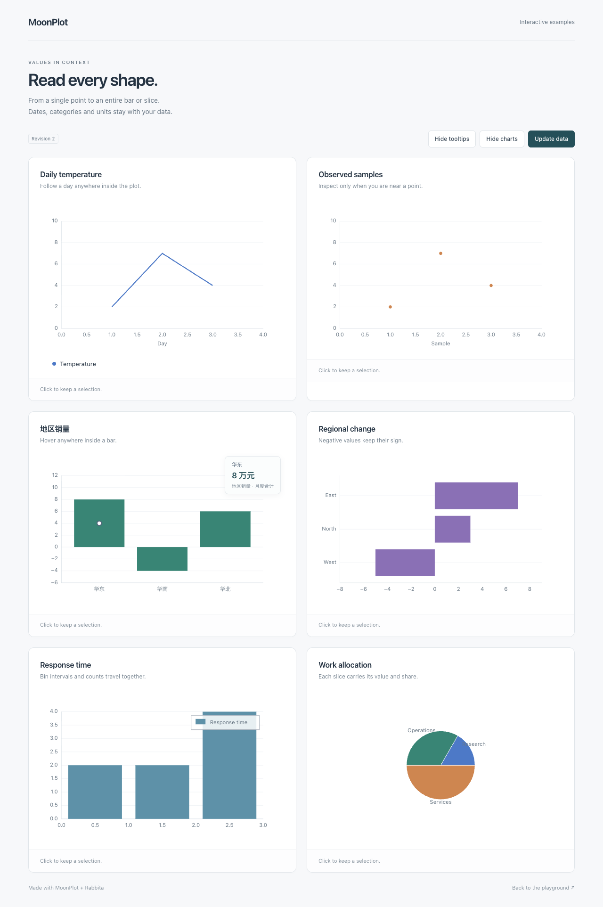

# 图表悬停与数值提示

0.3.0 增加常用图表的区域命中、折线横轴吸附和结构化提示信息。
这些数据来自绘制图表的同一次坐标变换，不需要应用解析 SVG、猜测柱宽或反推数值。
静态输出仍为原 SVG；浏览器行为位于同一模块的 `rabbita` 子包。

## 运行示例

从仓库根目录运行：

```sh
moon build rabbita/cmd/tooltips --target js
python3 -m http.server 8765 --bind 127.0.0.1
```

打开 [六类图表提示示例](http://127.0.0.1:8765/rabbita/tooltips.html)。
示例包含无圆点折线、散点、分类柱形、负数横向柱形、直方图和饼图，
也展示中文/日期/单位格式、自定义外观、数据更新、独立状态与重新挂载。
停止服务用 Ctrl+C。Python 仅用于静态文件服务。

在自己的应用安装：

```sh
moon add Lampese/mathplotlib@0.3.0
# 应用直接调用 Rabbita 框架 API 时也要声明框架依赖。
moon add moonbit-community/rabbita@0.16.7
```

导入与初始化方法见 [组件指南](../rabbita/README.md)和[安装说明](PUBLISHING.md)。
样式使用包内的 `rabbita/moonplot.css`，由应用复制到自己的静态资源。

## 命中范围

| 图表 | 命中行为 | 默认提示内容 |
| --- | --- | --- |
| 折线 | 默认在样本附近；开启 `XNearest` 后在所属面板内按屏幕横轴吸附实际样本 | 系列名、x/y；分类轴时给分类和数值 |
| 散点 / PathCollection | 样本附近，仍使用 CSS 像素半径 | 系列名、x/y或分类与数值 |
| 柱形 / 横向柱形 | 柱的整个矩形，包含负值；受当前面板边界约束 | 系列名、分类（有分类轴时）、值 |
| 直方图 | 实际绘制的柱形矩形 | 系列名、真实 bin 起止值、频数 |
| 饼图 | 实际扇区，包括完整单片圆 | 分类、值、占比 |
| 极坐标柱形／玫瑰图（0.18.0） | 实际可见扇形的整个填充区域；空角不因命中半径扩大 | 原Theta (rad)、Radius与系列；径上限裁剪仍返回原值 |
| 极坐标折线/散点/雷达（0.17.0） | 两种模式均选择圆内最近原采样点；不沿横轴跨圆吸附 | 原Theta (rad)、Radius及可选雷达Category |

`hit_radius~` 默认是 10 CSS 像素，用于点附近命中。
区域命中检查几何内部，不把半径扩散到柱间空白或饼图外部。
极坐标提示保留 `HitPoint.data_x` 的原theta弧度、`data_y` 与 `HitInfo.value` 的原半径，
`category` 属于原radar调用，不受后来刻度/图例改名影响。零半径保角度，缺失保索引洞，
闭合不增加第N个观测，超径轴上限的点保持静态；详见[极坐标指南](POLAR.md)。

`XNearest` 只改变普通折线的兜底选择，不会让散点或柱间空白自动变成整列命中。
先检查区域与半径内的散点，再为折线按横向距离选择；横向等距时按纵向距离打破平局，
仍返回真实采样点，不插值，也不使用阶梯线展开后的顶点。

只有所属面板范围内可以吸附；坐标轴标签、图例、面板外部和 letterbox 空白不会命中。
SVG 图例的实际矩形会屏蔽所属面板的命中，不会屏蔽同位置的其他重叠面板。
区域重叠时最后绘制的区域优先。命中是数据图元语义，不是所有像素的精确轮廓。

## 应用状态与自定义提示

既有 `Interaction::Hover(HitPoint?)`、`Click(HitPoint?)` 和 `ToggleSeries(String)` 保持可用。
应用仍负责保存 hover/selection，在数据替换或重排时刷新这些状态。
`Drawing::hit_info(point)` 返回该快照里该点的语义信息，界面也会拒绝本快照中找不到的旧点。

```moonbit nocheck
let chart = @plot_dom.view(
  drawing,
  id="sales",
  on_event=event => emit(Chart(event)),
  hovered?=model.hovered,
  selected?=model.selected,
  hit_mode=@drawing.HitMode::XNearest,
  tooltip=info => {
    let category = info.category.unwrap_or(info.point.data_x.to_string())
    @html.div([
      @html.b(info.series),
      @html.span("类别：" + category),
      @html.span("金额：" + info.value.to_string() + " 元"),
    ])
  },
  tooltip_class="sales-tooltip",
)
```

`tooltip` 回调只替换浮层内容，可以返回任意公开 Rabbita `Html`，无需自行定位浮层。
它只在显示有效 hover 时求值。`tooltip_visible=false` 隐藏浮层，但保留 hover/click 事件和选择。
日期/单位格式可由应用使用 `point.data_x`、`point.data_y` 和元数据自行格式化。
文本由 Rabbita 节点转义，不把标签当 HTML 插入。

浮层固定在图表视口右上角，不改变图表或图例布局，并且不会截获鼠标。
默认字段使用 `Range` / `Count` / `Share` 等英文标签；自定义回调可替换为中文。
样式可以覆盖 `.sales-tooltip` 或组件级 CSS 变量：

```css
#sales {
  --moonplot-text: #233746;
  --moonplot-tooltip-background: #f4faf8;
  --moonplot-border: #c8ded8;
}
#sales .sales-tooltip { border-radius: 10px; }
```

## 结构化数据与无 UI 命中

从 `Lampese/mathplotlib/drawing` 可使用以下类型；根包也重新导出这些类型：

- `HitPoint`：panel/artist/原始 sample 索引、数值 x/y、内在 SVG x/y，原字段保持不变。
- `HitInfo`：`point`、`kind`、`series`、`category?`、`value`、`interval?`、`fraction?`。
- `HitKind`：`Line`、`Scatter`、`Bar`、`BarH`、`Histogram`、`Pie`。
- `HitTarget`：`info`、`shape` 和实际面板的 `bounds`。
- `HitShape`：点、矩形或扇区，坐标与同一 Drawing 的 SVG 一致。

`value` 对横向柱是宽度对应的数值；对普通纵向柱是高度对应的数值；
对直方图是该 bin 的频数；对饼图是原始 slice 值。
`interval` 只对直方图给出真实边界，区间端点没有人为格式精度截断；
分箱规则为通常的左闭右开，最后一箱包含上界。
`fraction` 对饼图是 0–1 的占比，默认 UI 转成百分数、最多两位小数。
数值轴柱形没有分类名时 `category=None`，不从轴的装饰性 tick 标签猜分类。

`Drawing::targets()`、`points()` 返回独立数组，外部修改不会改变快照。
旧的手工 `drawing(width,height,svg,points)` 仍支持原来的点命中；
`targets~` 可选参数允许其他生产者提供结构化区域；
`exclusions~` 接收 `(panel_index, (left, top, width, height))` 数组，供自定义生产者声明遮挡矩形。
不依赖浏览器时可以调用 `hit_test(x,y,mode=XNearest)`；
`hit_test_client(...)` 另外处理 CSS 比例、滚动和 `xMidYMid meet` letterbox。

## 三角面着色（M13）

`Tripcolor` 使用 `HitInfo.value` 保留原逐面标量或原顶点算术均值，
`HitInfo.tricolor.vertices` 给出实际有序顶点三元组，`vertex_mean` 区分两种来源。
`point_index` 保留原面槽与掩码空位；两种模式只命中 plot 内实际填色。
默认显示系列与 Value 或 Vertex mean，自定义回调可提供中文与单位；
不把几何锚点当作原始网格观测。见[三角面指南](TRIPCOLOR_INTERACTION.md)和[M13验收状态](MILESTONE_M13.md)。

## 实际预览



这是 Chrome 中的实际组件截图；交互另外由真实鼠标事件验收。

## 验收与边界

新增绘制路径和几何均有断言测试：Drawing 四目标各 **23/23**，Scene/SVG 语义定向四目标各 **17/17**，
Rabbita JS **17/17**（包含原资源解析与新增提示测试）。
Chrome 156 的六图专项 **14 组**、原主示例 **11 项**、资源专项 **7 组**均通过，页面错误为 0。
实际生产 ZIP 与 Mooncakes 0.3.0 的独立消费者均通过四目标静态与浏览器 **6 项**验收，
registry 安装的 493 个文件与正式 ZIP 逐一相同；[GitHub v0.3.0](https://github.com/moonbit-community/moonplot/releases/tag/v0.3.0) 的四份附件也已回下载核对。

浏览器专项使用实际 SVG DOM 和鼠标，
在柱内部远离锚点、折线远离顶点的纵向位置、饼图扇区内触发，验证默认和自定义提示。
实际结果与命令记录在 [执行检查点](MIGRATION_STATUS.md)，不把历史版本测试算成本轮结果。

触摸、缩放/平移、键盘点导航、其他图表轮廓和大数据索引仍不属于本次范围。
命中数据按当前帧索引；每次 view 解析 SVG，查询线性扫描 targets。
直接施加在 SVG 根上的任意 CSS transform/border/padding 仍未覆盖。
